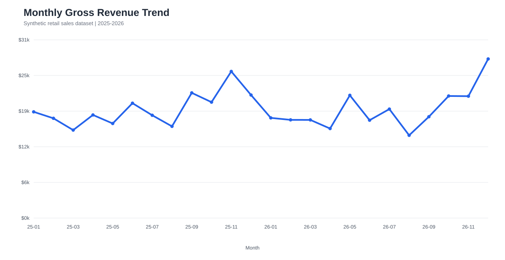
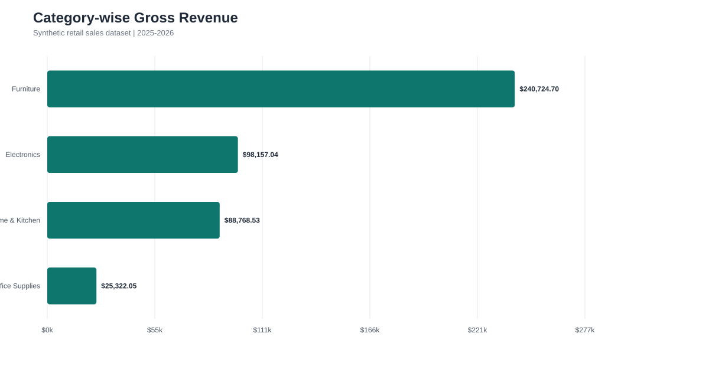
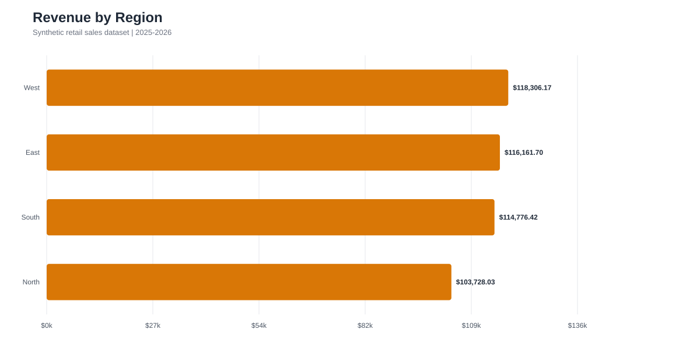

# Sales Data Analysis

### CodeNova Data Science Internship - Task 1



**A portfolio-ready commercial-intelligence analysis of retail sales performance, with reconciled KPIs, category and regional views, and seasonality insights.**

## Project overview

This project analyzes category, regional, and seasonal retail-sales performance. It calculates reconciled commercial KPIs and produces stakeholder-ready chart exports.

> **Data note:** No source dataset accompanied the assignment. This project therefore uses a deterministic synthetic retail dataset, generated locally with a fixed seed. It is suitable for demonstrating the requested analysis workflow, but it must not be interpreted as actual business performance.

## Deliverables

- `sales_data_analysis.ipynb` - executed Jupyter notebook with core metrics and takeaways.
- `data/synthetic_retail_sales.csv` - 1,440 synthetic order records.
- `outputs/*.svg` - high-resolution, vector chart exports.
- `outputs/analysis_summary.json` - machine-readable KPI and group summaries.
- `run_analysis.js` - fully reproducible generator and analysis pipeline.
- `report.html` - polished, browser-ready executive report for a non-technical audience.

## Metrics

| Metric | Definition |
| --- | --- |
| Total gross revenue | Sum of all order `gross_revenue` values |
| Total profit | Sum of `gross_revenue - cost` |
| Profit margin | Total profit divided by total gross revenue |
| Average order value | Total gross revenue divided by order count |
| Unit volume | Sum of `units_sold` |

## Run the project

No packages are required. From this folder, run:

```powershell
node run_analysis.js
```

This safely regenerates the synthetic dataset, chart exports, summary, and executed notebook. The fixed random seed makes every output reproducible.

To view the executive report, open `report.html` in any modern browser. It has no hosting, API, or paid-tool requirement.

## Key business insights

1. Use the category revenue chart to prioritize inventory and campaign budgets for the largest sales contributor.
2. Use the category-margin chart to protect or expand high-margin lines, especially when offering discounts on lower-margin products.
3. The monthly trend reveals year-end seasonality. Commit inventory and campaign capacity before the peak rather than reacting after demand rises.
4. Compare regional revenue before allocating local promotions; target the lowest-performing region with testable, time-bound offers.

## Quality checks

The pipeline calculates totals from the same transaction rows used in each group. Category, regional, monthly, and quarterly grouped totals reconcile to the overall financial totals (allowing only for currency rounding at transaction level).

## Limitations

The dataset is synthetic, contains no returns or marketing-spend fields, and does not establish causal explanations for sales changes. Before operational use, replace it with validated business data and add returns, customer segments, inventory, and campaign-cost data.

## Repository structure

```text
task1_sales_analysis/
├── data/                         # generated transaction-level data
├── outputs/                      # vector charts and reconciled KPI summary
├── sales_data_analysis.ipynb     # executed submission notebook
├── report.html                   # executive-ready visual report
├── run_analysis.js               # reproducible analysis pipeline
└── README.md                     # project explanation and recommendations
```

## Screenshots / visual outputs

| Category performance | Regional performance |
| --- | --- |
|  |  |

